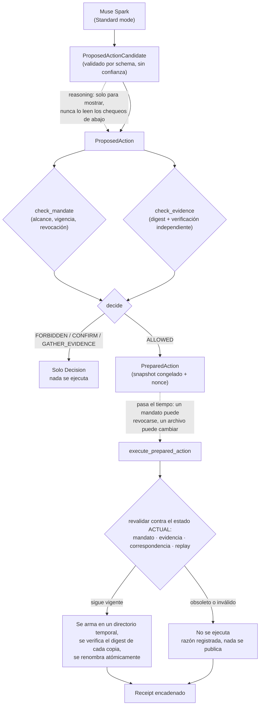

# KRAKADYL

**Un agente de investigación activa para trabajo forense bajo presión de tiempo.**

KRAKADYL mantiene un caso organizado, identifica qué evidencia falta
*mientras todavía se puede recuperar*, y coordina el siguiente paso
verificable — dentro de un mandato que nunca amplía en silencio. No
decide qué prueba la evidencia; eso sigue siendo del motor de inferencia
y de la persona investigadora. Ayuda a que la investigación llegue a esas
herramientas mejor preparada.

> Read this in English: [README.md](README.md)

Construido durante el [Meta Global AI Developer Hackathon](https://cerebralvalley.ai/e/meta-ai-developer-hackathon)
(building period: 27 oct – 4 nov 2026) por [Anna Tchijova](https://github.com/annatchijova).

## El escenario para el que existe

Una investigación no siempre fracasa porque alguien cometió un error. A
veces fracasa porque todos creyeron que otra persona ya había hecho
algo.

Imaginemos a tres investigadores trabajando en el mismo caso. Se asignó
una tarea de adquisición de evidencia. Alguien informó que estaba
terminada. Otro investigador asumió que la evidencia ya había sido
preservada.

Pero nadie lo verificó independientemente.

Cuando se descubre la discrepancia, es posible que esa evidencia ya no
exista.

Esto no es solamente un problema técnico. También es un problema de
coordinación, carga cognitiva, memoria de trabajo y funciones
ejecutivas. Los investigadores enfrentan interrupciones, cambios de
prioridades, jornadas extensas, información incompleta y relevos entre
equipos — la experiencia técnica no convierte la atención ni la memoria
humana en recursos ilimitados.

## Por qué existe

Trabajando con sus propias herramientas forenses/DFIR, Anna se encontró
una y otra vez con el mismo problema: un motor de inferencia como
[VIGÍA](https://github.com/annatchijova/vigia-intent-analysis) puede
responder correctamente `ABSTAIN` — la evidencia no permite concluir —
pero para ese momento, lo que falta muchas veces ya no se puede
recuperar: un artefacto volátil que no se preservó, un campo de cadena
de custodia que no se registró, una fuente que quedó inaccesible. El
costo de enterarse tarde no es simétrico con el costo de enterarse a
tiempo.

KRAKADYL es la capa que corre *antes* de eso — diseñada para:

- Preservar la continuidad de una investigación entre personas, turnos e interrupciones.
- Distinguir entre trabajo asignado, aceptado, reportado como realizado y verificado independientemente.
- Identificar evidencia faltante mientras todavía sea posible recuperarla.
- Registrar incertidumbres, información contradictoria y responsabilidades — sin atribuir culpas personales.
- Ayudar a los investigadores a identificar el siguiente paso concreto y verificable, sin necesidad de reconstruir mentalmente todo el expediente.
- Mantener las propuestas generadas por IA separadas de la autoridad verificada, mediante decisiones de autorización deterministas y registros auditables.

**KRAKADYL no decidirá qué demuestra la evidencia.** Esa
responsabilidad corresponde al investigador y a los sistemas de
análisis apropiados. Su función es ayudar a las personas y a los
equipos a llegar a esas decisiones con evidencia mejor preservada,
menos omisiones evitables y una comprensión más clara de lo que todavía
se desconoce — para que quien investiga (junior o con experiencia,
cualquiera bajo presión de tiempo) llegue a VIGÍA, SIFT, o cualquier
otra herramienta de análisis con un caso que realmente está listo para
evaluarse.

**La métrica que importa es reducir los `ABSTAIN` evitables por
preparación incompleta — sin tocar los `ABSTAIN` que son realmente
necesarios.** Un caso que KRAKADYL no puede completar tiene que cerrar
honestamente como "esta evidencia no está disponible", nunca como una
narrativa forzada para que parezca completo.

Esto refleja algo que Anna considera fundamental, no incidental: **la
competencia técnica y la capacidad de las funciones ejecutivas son
variables independientes.** Las buenas herramientas deberían contemplar
ambas — ver [docs/terminal-first-and-blame.md](docs/terminal-first-and-blame.md)
para el origen de ese principio.

## Cómo se conecta con el resto del ecosistema

| Sistema | Responsabilidad |
|---|---|
| Herramientas de adquisición/análisis (Velociraptor, SIFT, i2, etc.) | Obtener y examinar artefactos según sus propias capacidades |
| [VIGÍA](https://github.com/annatchijova/vigia-intent-analysis) u otro motor de inferencia | Decidir qué sostiene la evidencia — incluyendo un `ABSTAIN` legítimo |
| **KRAKADYL** | Mantener el caso organizado, identificar qué falta, coordinar el siguiente paso de investigación |
| La persona investigadora | Define el alcance, autoriza las acciones, ejerce criterio profesional |

KRAKADYL no reemplaza ni vuelve a decidir lo que estos sistemas ya hacen
bien. Es la pieza que faltaba río arriba de ellos — emparentado en
espíritu con [ZAYNOR](https://github.com/annatchijova/zaynor) (memoria de
investigación case-bound y verificación de auditoría) y
[ANNACONDA](https://github.com/annatchijova/annaconda) (flota de agentes
DFIR autónomos con veredicto sellado, defendible en sede judicial) del
mismo portfolio, y con [VELO](https://github.com/annatchijova/velo)
(attestation de conocimiento cero para veredictos forenses) para todo lo
que eventualmente necesite probarse sin exponer la evidencia subyacente.

Integraciones objetivo a medida que el proyecto crece: **Velociraptor**
(adquisición), **SIFT Workstation**, **i2 Analyst's Notebook**, y VIGÍA
mismo — cada una como un adaptador con su propio contrato explícito, no
como un supuesto fijo en el código.

## Arquitectura, en un párrafo

Un agente propone una acción (con Muse Spark de Meta para razonamiento y
uso de herramientas, y SAM 3.1 para anclaje visual cuando el caso tiene
imágenes o video). Un sensor semántico tipado
([Laya](https://github.com/NandhaKishorM/laya)) interpreta contexto no
estructurado en señales tipadas — nunca otorga autoridad por sí mismo,
una señal probabilística no es un hecho verificado. El entorno aporta los
hechos verificables (quién otorgó qué permiso, sobre qué recurso, con qué
alcance y vigencia). Un motor de políticas determinista decide `ALLOWED`
/ `CONFIRM` / `GATHER_EVIDENCE` / `FORBIDDEN` sobre la acción tipada más
esos hechos verificados — nunca sobre la interpretación del modelo o del
sensor solos. Cada decisión genera un recibo encadenado, verificable de
forma independiente.

Esta separación — el modelo propone, un sensor interpreta, el entorno
verifica, un motor determinista decide — no es nueva en sí misma; ver los
agradecimientos más abajo para el antecedente más cercano, leído y
verificado antes de que este proyecto reclamara cualquier novedad.

Muse nunca tiene un camino hacia la autoridad: su salida es un candidato
tipado, rechazado directamente si no cumple el schema, y todavía tiene
que pasar por `check_mandate`/`check_evidence` igual que una acción
armada a mano — confirmado en vivo contra la API real de Meta en
`demo/run_case_001_with_muse.py`, no simulado.

Dos fases, no una: `prepare_evidence_package` decide y toma el snapshot;
`execute_prepared_action` no confía en nada de ese snapshot sin
revisarlo de nuevo, inmediatamente antes de actuar. Se produce un
receipt en cualquier caso — "esto se rechazó, y esta es exactamente la
razón" queda tan registrado como "esto se ejecutó".

## Probalo

`krakadyl/api/` expone este mismo núcleo, sin modificar, sobre HTTP
(FastAPI), con persistencia real (`krakadyl/store.py` — un caso
sobrevive a un reinicio del servidor o a recargar la página), y
`frontend/` es un workspace en React + TypeScript sobre eso: Mission,
Evidence, Next move, Activity e Hypotheses, recorriendo el mismo caso
de dos dispositivos que usan los demos. Cada botón llama a un endpoint
real; nada en la interfaz vuelve a decidir lo que el ejecutor ya
decidió. Ver `frontend/README.md` para correr ambos.

## No es solo para forense

KRAKADYL se publica bajo licencia abierta específicamente para que no
quede atado a un solo dominio de investigación. El mecanismo central —
registrar qué se desconoce, resolver lo que todavía se puede resolver,
actuar solo dentro de un mandato verificado, cerrar honestamente cuando
algo ya no se puede recuperar — se generaliza a cualquier investigación
bajo presión de tiempo e información incompleta: respuesta a incidentes e
investigaciones de ciberseguridad (las personas con las que Anna trabaja
en forense e infosec son las primeras que de verdad usarían esto),
periodismo, y — un dominio que Anna considera directamente relevante —
**investigaciones de AI safety**, donde "qué sabemos realmente, qué sigue
faltando, y qué ya no se puede verificar" es la misma pregunta con otro
expediente. El dominio forense DFIR es la primera experiencia completa y
demostrable porque es donde Anna tiene criterio propio real y
verificable — no porque la arquitectura sea específica de forense.

## Alcance y honestidad sobre en qué punto está esto

Esto se construyó bajo la restricción real de un building period de 9
días de hackathon (27 oct – 4 nov 2026), sin estirarlo para que parezca
más grande de lo que es. Los niveles no alcanzados para el deadline de
submission quedan documentados como roadmap, no simulados como si ya
estuvieran construidos. Ver `docs/` para los niveles de arquitectura, el
diseño del benchmark, y qué es genuinamente nuevo acá versus qué es
prior art (reconocido explícitamente, no disimulado).

**Este proyecto sigue después del hackathon, gane o no.** Se construyó
para usarse — por Anna, y por la gente de forense y ciberseguridad de su
propia red — no para abandonarse apenas termine el judging.

## La metodología detrás de cómo se construye esto

Los niveles no se "recortan para caber en el deadline" — se construyen
hacia un destino conocido y ambicioso (un producto pensado para quedarse
y usarse durante meses), y lo que varía con el tiempo disponible es
cuántos niveles coherentes se alcanzan, nunca qué tan completos son los
niveles que efectivamente se intentan. Esto sigue la skill de ingeniería
propia de Anna:
[destination-driven-construction](https://github.com/annatchijova/SKILLS/tree/main/destination-driven-construction)
(parte de su colección [SKILLS](https://github.com/annatchijova/SKILLS)).

## Agradecimientos y antecedentes

Ninguna parte de este proyecto se presenta como la invención de agentes
con autoridad acotada, benchmarks de autorización de agentes, ni capas de
gobierno deterministas — todo eso ya existe, verificado contra la fuente
antes de escribir este README:

- [Muse](https://about.fb.com/news/2026/09/introducing-muse-personal-ai-agent/)
  de Meta ya es un agente personal que maneja objetivos amplios entre
  apps, y [Sentinel](https://research.meta.ai/blog/security-and-safety-for-ai-agents-our-approach-with-muse)
  ya es una autoridad determinista del lado del host, separada del
  modelo, que gobierna conectores y salida de red.
- [AgentBound](https://arxiv.org/abs/2606.30970) — gobierno determinista
  entre autorización y ejecución, con recibos criptográficos por acción.
- [AuthorizationBench](https://arxiv.org/abs/2610.27548) — mide
  exactamente la afirmación de que completar la tarea no implica
  respetar la autorización.
- [AuthorityBench / Veto](https://github.com/yazcaleb/can-is-not-may) —
  intercepción determinista de autoridad, y el hallazgo de que acciones
  individualmente permitidas pueden combinarse en una violación
  (tool-chaining).
- [Bounded Agents / APC](https://arxiv.org/abs/2608.15888) — límites de
  delegación aplicados vía composition closure sobre el historial de
  acciones.
- [Rehearsal](https://github.com/dhansxd/rehearsal) — ensayar
  consecuencias antes de aprobar una acción.
- [Laya](https://github.com/NandhaKishorM/laya) — el sensor semántico
  tipado que se usa acá.

Lo que este proyecto reclama como contribución propia es la combinación
específica: un agente personal construido sobre los modelos de Meta, al
que se le da un objetivo amplio en vez de una secuencia de órdenes, que
investiga lo que no sabe antes de interrumpir a una persona, distingue
"un documento dice que tengo permiso" de "tengo un permiso verificado", y
se evalúa sobre casos del dominio de investigación — no la existencia de
capas de autoridad o benchmarks de autorización en general, que ya
pertenecen a los proyectos listados arriba.

## Licencia

Apache License 2.0 — ver [LICENSE](LICENSE). Pública y abierta desde el
primer commit, para que cualquiera pueda leerla, adaptarla o extenderla
para su propio dominio de investigación.
